<div align="center">

```
╔══════════════════════════════════════════════════════════════════╗
║  sushil@github  ~  $  ./profile.sh                              ║
╚══════════════════════════════════════════════════════════════════╝
```

</div>

<div align="center">
<table>
<tr>
<td width="370" valign="top">

<!-- ASCII headshot (placeholder until photo is supplied) -->


</td>
<td width="490" valign="top">

<!-- Neofetch-style info card -->


</td>
</tr>
</table>
</div>

<br/>

<div align="center">

```
╔══════════════════════════════════════════════════════════════════╗
║  sushil@github  ~  $  ./contributions.sh                        ║
╚══════════════════════════════════════════════════════════════════╝
```

<!-- Contribution heatmap (auto-updated daily via GitHub Actions) -->


</div>

<br/>

---

<div align="center">

### ⚡ Tech Stack

<a href="https://skillicons.dev">
  
</a>

<br/>

<a href="https://skillicons.dev">
  
</a>

<br/>

<a href="https://skillicons.dev">
  
</a>

<br/>

<a href="https://skillicons.dev">
  
</a>

</div>

<br/>

---

<div align="center">

### 📬 Connect

<a href="https://linkedin.com/in/sushilthakare">
  
</a>
<a href="mailto:sushil.thakare.work@gmail.com">
  
</a>
<a href="https://github.com/SushilThakare">
  
</a>

<br/><br/>


</div>
